# Greenhouse HMSG — Team Architecture Diagrams

Visual documentation of the Greenhouse HMSG system for robotics, perception, VLM/AI, and web teammates.

Each diagram is provided in **three formats**:
- **SVG** (`docs/diagrams/*.svg`) — crisp vector graphics for docs, wikis, and web
- **High-DPI PNG** (`docs/diagrams/*.png`) — ready to drop into slides and `.docx` reports
- **Editable Mermaid source** (below) — renders natively in GitHub, VS Code, Notion, and GitLab

To regenerate all SVG and PNG files after editing layout/text:
```bash
python3 docs/diagrams/generate_diagrams.py
```

| # | Diagram | Target Audience | Assets |
|---|---|---|---|
| 1 | End-to-End Pipeline (M1–M8.2.1) | Whole team / stakeholders | [SVG](diagrams/01_end_to_end_pipeline.svg) · [PNG](diagrams/01_end_to_end_pipeline.png) |
| 2 | HMSG Scene Graph & SQLite Schema | Backend & data engineers | [SVG](diagrams/02_hmsg_scene_graph_and_schema.svg) · [PNG](diagrams/02_hmsg_scene_graph_and_schema.png) |
| 3 | Fast-to-Slow Query & Dialogue Sequence | VLM / AI & Web engineers | [SVG](diagrams/03_fast_to_slow_query_sequence.svg) · [PNG](diagrams/03_fast_to_slow_query_sequence.png) |
| 4 | 3D Coordinate & Frame Transform Chain | SLAM & perception engineers | [SVG](diagrams/04_coordinate_3d_projection_chain.svg) · [PNG](diagrams/04_coordinate_3d_projection_chain.png) |
| 5 | Truth & Navigation Safety Boundary | Robotics safety / Nav2 / KPI leads | [SVG](diagrams/05_truth_and_safety_boundary.svg) · [PNG](diagrams/05_truth_and_safety_boundary.png) |
| 6 | Multi-Provider Agent Workspace & Edit Boundaries | Engineering leads & AI agents | [SVG](diagrams/06_repo_boundaries_and_agents.svg) · [PNG](diagrams/06_repo_boundaries_and_agents.png) |

---

## 1. End-to-End Pipeline (Offline Mapping + Online Query)

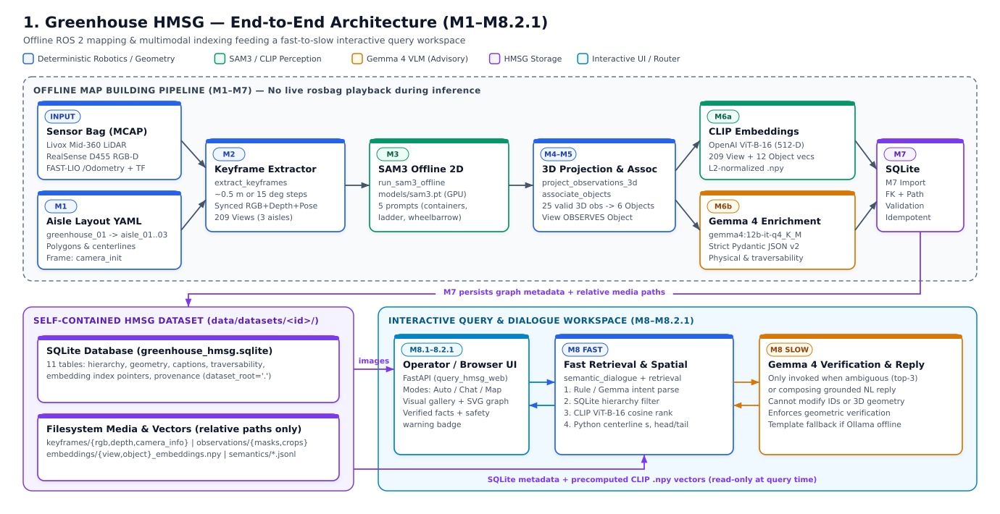

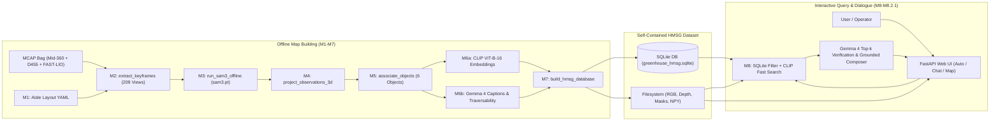

---

## 2. HMSG Scene Graph Hierarchy & SQLite Schema

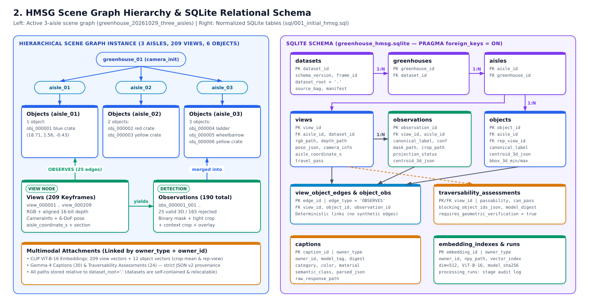

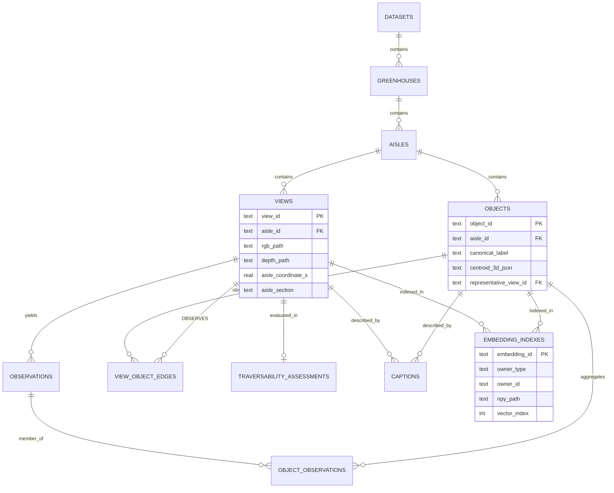

---

## 3. Fast-to-Slow Query & Semantic Dialogue Sequence

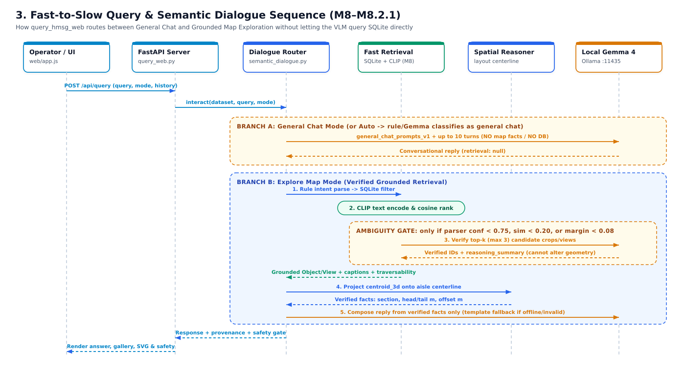

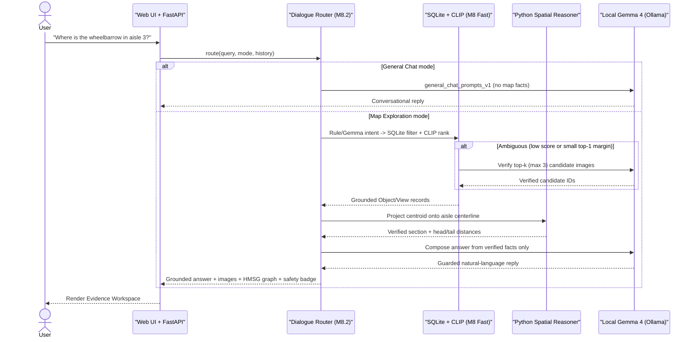

---

## 4. 3D Coordinate & Frame Transform Chain

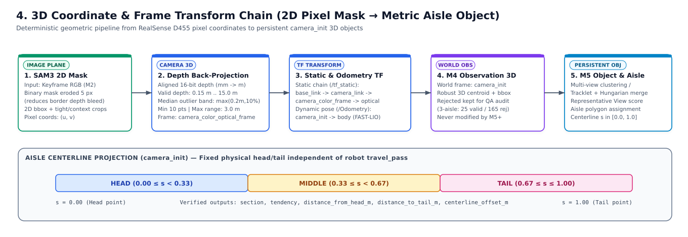

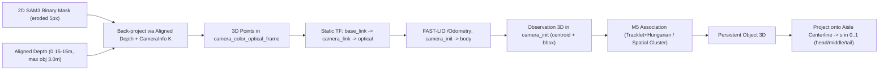

---

## 5. Truth & Navigation Safety Boundary

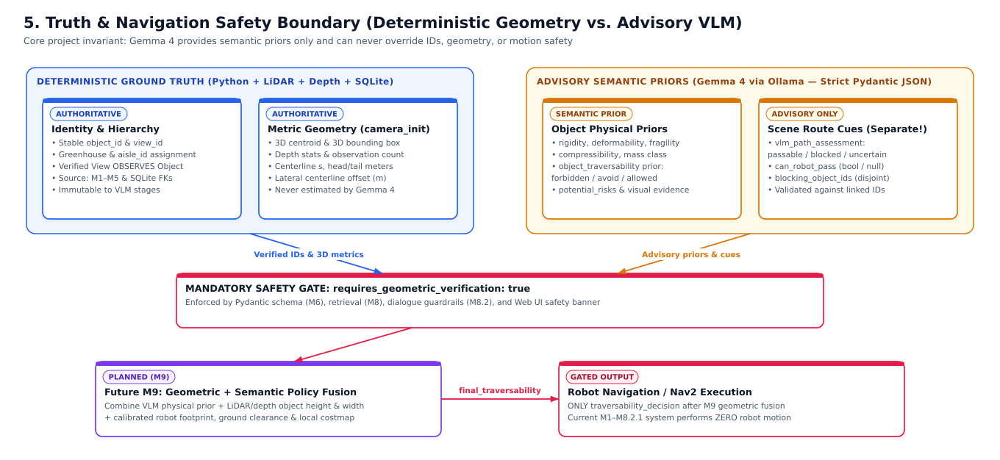

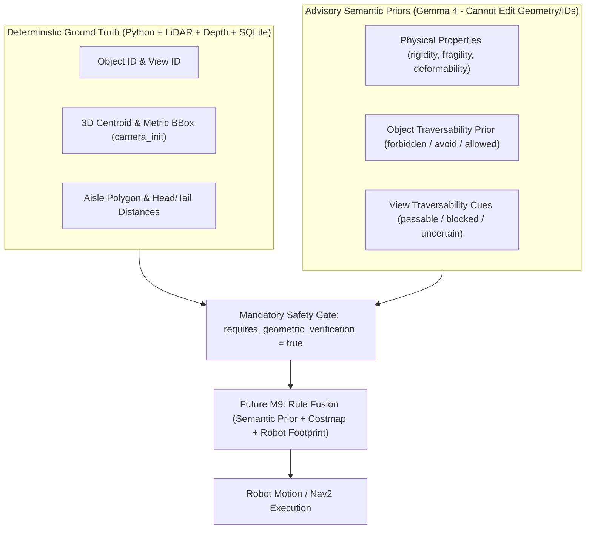

---

## 6. Multi-Provider Agent Workspace & Repository Edit Boundaries

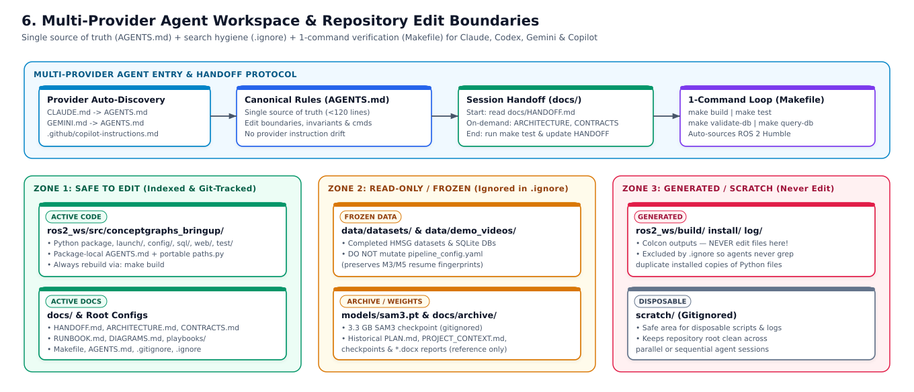

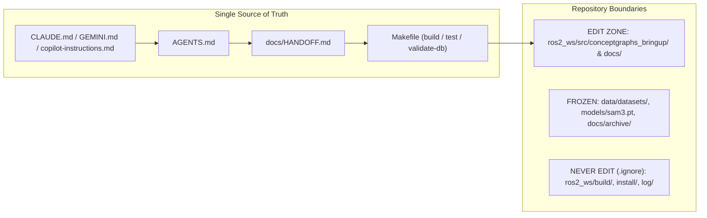
